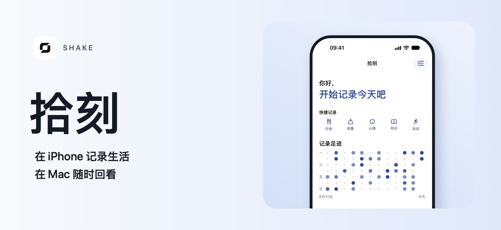
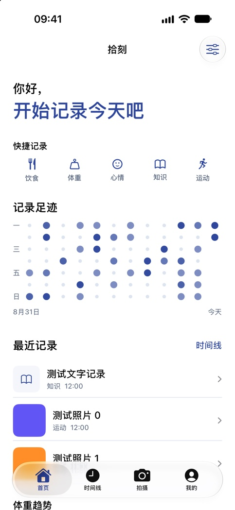
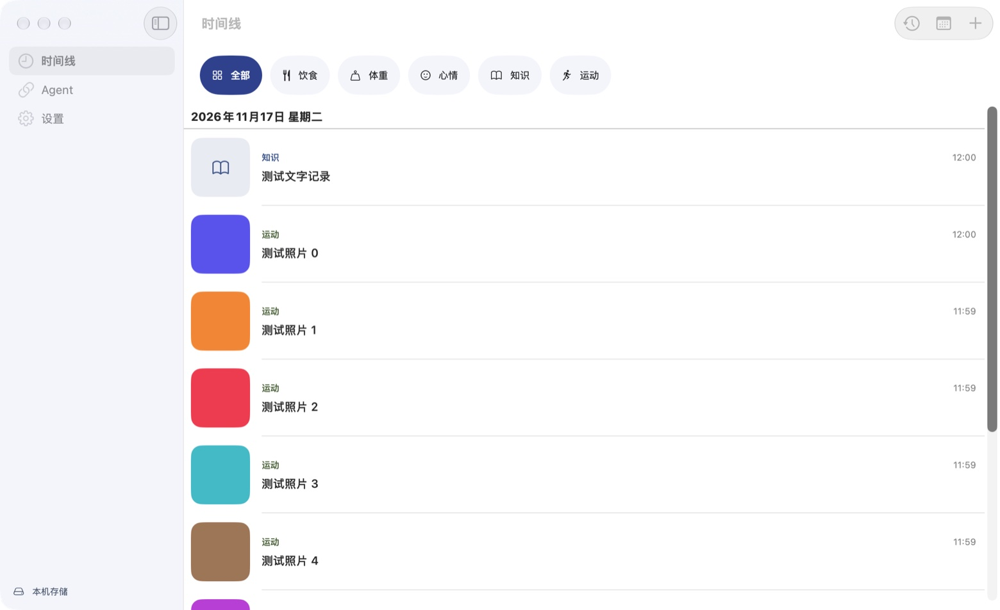

<h1 align="center">拾刻 · Shake</h1>



<p align="center">
  <a href="#界面预览">界面预览</a> ·
  <a href="#使用方法">使用方法</a> ·
  <a href="#从源码运行">从源码运行</a> ·
  <a href="#cloudkit-配置">CloudKit 配置</a> ·
  <a href="#测试">测试</a> ·
  <a href="#许可证">许可证</a>
</p>

拾刻是面向 iPhone 和 Mac 的本地优先生活记录工具。拍下一餐、手动记一次体重，或存下一条学到的知识，之后可以按日期和类别回看。如果你平时用 Codex 等个人 Agent，也可以在 Mac 上按需开放只读访问，让它根据你选定的记录做回顾。

## 界面预览

以下为 iPhone 模拟器和 Mac 上运行的拾刻，使用独立测试库中的合成记录。iPhone 首页的「记录足迹」展示近 12 周的示例活动。

<p align="center">
  
  
</p>

## 使用方法

### iPhone 记录，Mac 回看

- **记录**：在 iPhone 的「拍摄」页拍照，确认端侧分类后保存。也可以从首页手动新增，按需从相册选图。常用类别包括饮食、体重、心情、知识和运动。
- **回看**：在时间线和日历按日期、类别查找记录，打开详情查看照片与字段，也可以编辑、删除或从「最近删除」恢复。Mac 提供更宽的时间线工作区，方便集中回看。
- **存储**：两端先写入各自的本机 SQLite，照片单独存放。照片文件会清理位置元数据，记录中单独保存的拍摄地点会随备份和同步转移。

### 局域网同步

1. 将 iPhone 和 Mac 连到同一 Wi-Fi。
2. 在 Mac 打开「设置 → 局域网同步」，点击「开启接收」，保持页面打开。
3. 在 iPhone 打开「我的 → 局域网同步」，扫描 Mac 上的二维码，确认接收端后点击「同步到 Mac」。

这是 iPhone 向 Mac 发起的手动同步。接收限时开放，传输经配对密钥加密，已存在的同 ID 记录会跳过。默认 Debug 构建可使用该流程。

### CloudKit 同步

使用按下文签名的 CloudKit 构建，并在 iPhone 和 Mac 登录同一 Apple 账户。到「我的」或「设置」里的「iCloud 同步」确认账户并启用。拾刻将记录和照片同步到该账户的 CloudKit 私有数据库。

### 导出备份

在 iPhone 的「我的」或 Mac 的「设置」选择「导出备份」。保存的 ZIP 包含当前未删除记录的清单和本机已有的关联照片文件。应用界面提供导出入口，备份导入目前没有界面入口。

### 本机 MCP

在 Mac 的「Agent」页点击「启动服务」，或通过拾刻菜单栏开启 MCP。服务监听 `127.0.0.1:17876`，同一台 Mac 上的客户端可以只读查询记录和照片。关闭服务即可撤销访问。

例如，将拾刻接入同一台 Mac 的 Codex：

```sh
codex mcp add shake --url http://127.0.0.1:17876/mcp
```

重新打开 Codex 会话后，可先调用 `list_categories` 检查连接。需要按场景回顾生活记录时，可在拾刻的 Agent 页安装 `shake-life-log` Skill。见 [Agent 接入说明](Skills/shake-life-log/setup.md)。

## 从源码运行

- **系统要求**：应用目标为 iOS 17+、macOS 14+。开发需要一台 Mac，以及提供 Swift 5.9 或更新版本、支持所选 iOS 模拟器或真机的 Xcode。
- **Xcode 工程**：克隆本仓库后打开 [Shake.xcodeproj](Shake.xcodeproj)。iPhone 选用 `Shake-iOS` Scheme 和 iPhone 模拟器，Mac 选用 `Shake-macOS` Scheme 和「My Mac」。直接 Run 即可构建并启动。
- **默认 Debug**：以本机模式运行，可在模拟器与 Mac 上使用本机记录和相应功能，无需配置 CloudKit。要部署到自己的 iPhone，请在 iOS Target 的「Signing & Capabilities」设置可用签名团队和 Bundle ID，连接已启用开发者模式的设备，选择该设备后 Run。
- **更新工程**：增删 App 源文件后，可安装 XcodeGen 并在根目录运行 `xcodegen generate`。已有工程可直接打开，Swift Package 会自动识别共享源码。

可用以下命令检查 Debug 构建：

```sh
xcodebuild -project Shake.xcodeproj -scheme Shake-iOS -configuration Debug \
  -destination 'generic/platform=iOS Simulator' CODE_SIGNING_ALLOWED=NO build
xcodebuild -project Shake.xcodeproj -scheme Shake-macOS -configuration Debug \
  -destination 'platform=macOS' CODE_SIGNING_ALLOWED=NO build
```

## CloudKit 配置

当前维护者没有 Apple Developer Program 会员资格。CloudKit 的签名真机双端同步、推送和生产容器尚未完成端到端验证。

1. 使用有效的 Apple Developer Program 会员资格及有配置权限的签名团队。在 Xcode 为 `Shake-iOS` 和 `Shake-macOS` 两个应用目标选择该团队并配置签名。
2. 在团队下为两个 App 注册各自的 Bundle ID，替换 [project.yml](project.yml) 中默认的 `cn.shake.lifelog.ios` 和 `cn.shake.lifelog.mac`。使用 XcodeGen 重新生成工程，并核对签名设置。
3. 为两个 App 启用 iCloud（CloudKit）和 Push Notifications，并关联到同一个团队所有的 iCloud 容器。将默认容器 `iCloud.cn.shake.lifelog` 替换为你自己的容器，更新 [iOS entitlements](Apps/iOS/Shake.entitlements)、[macOS entitlements](Apps/macOS/Shake.entitlements) 和 [CloudSync.swift](Sources/ShakeCore/CloudSync.swift)。
4. 保留 iOS 的后台远程通知配置，确认签名后的 Push entitlement 与构建环境匹配。将 Scheme 的 Run 配置改为 `CloudDevelopment`，用同一 Apple 账户在 iPhone 和 Mac 上测试。需要生产部署时，在 CloudKit Dashboard 部署已验证的 schema，再以 `CloudProduction` 检查生产容器、推送与同步。

[Apple 的 CloudKit 配置文档](https://developer.apple.com/documentation/cloudkit/enabling-cloudkit-in-your-app)

## 测试

在项目根目录运行：

```sh
swift test
```

Swift Package 测试覆盖记录模型、SQLite、备份、局域网同步和 Mac 本机 MCP 等逻辑。部分局域网用例需要 Mac 具备私有 IPv4 地址。要运行界面测试，在 Xcode 用 `Shake-iOS` 选择已启动的 iPhone 模拟器，或用 `Shake-macOS` 选择「My Mac」，然后选择 Product → Test。

## 项目结构

| 路径 | 内容 |
| --- | --- |
| `Apps/iOS`、`Apps/macOS` | 两端入口和平台功能 |
| `Sources/ShakeCore`、`Sources/ShakeUI` | 数据层、同步和共享界面 |
| `Sources/ZIPFoundation` | 随项目构建的 ZIP 支持 |
| `Tests` | Swift 测试、界面测试及合成素材 |
| `Skills/shake-life-log` | 接入本机 MCP 的可选 Agent Skill |

## 许可证

拾刻自有代码使用 [MIT 许可证](LICENSE)。

内置的 ZIPFoundation 0.9.20 使用 MIT 许可证，见 [ZIPFoundation 版权声明和许可全文](docs/ZIPFoundation-LICENSE)。
